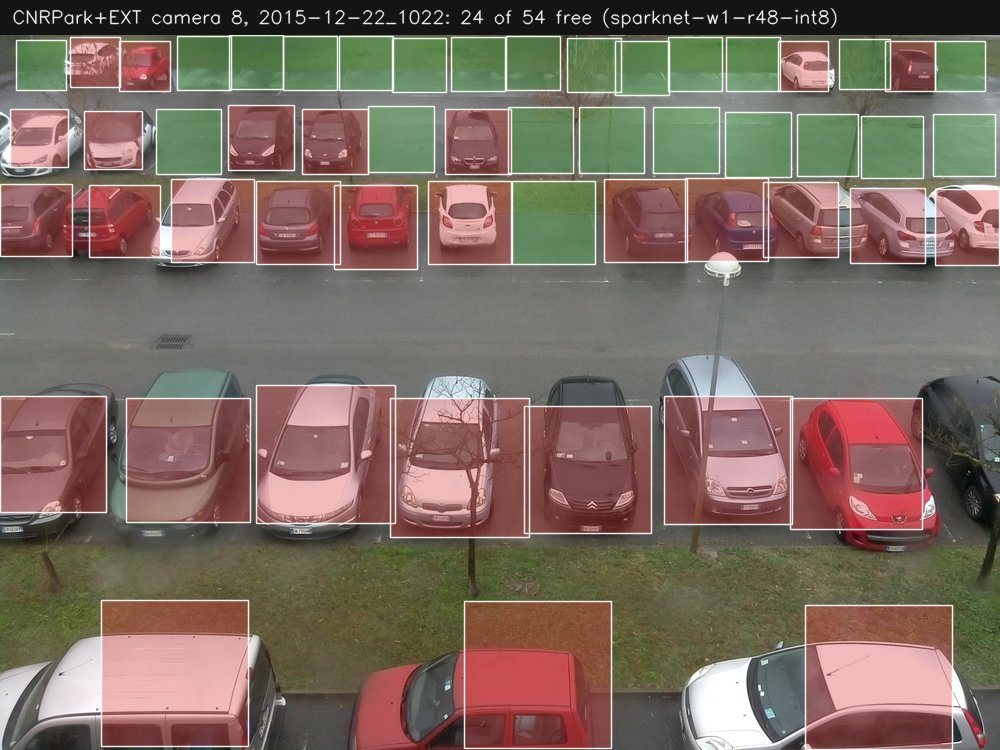
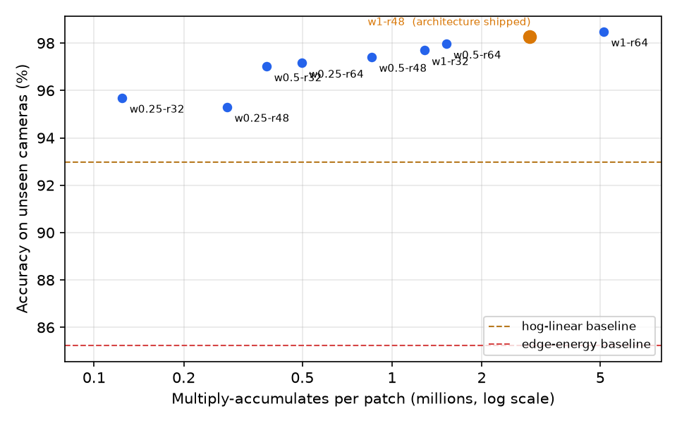
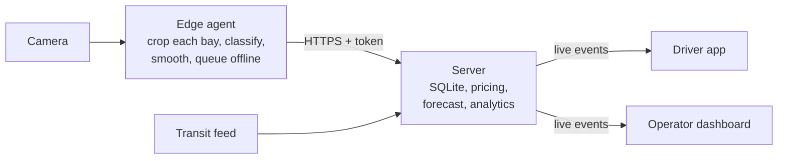
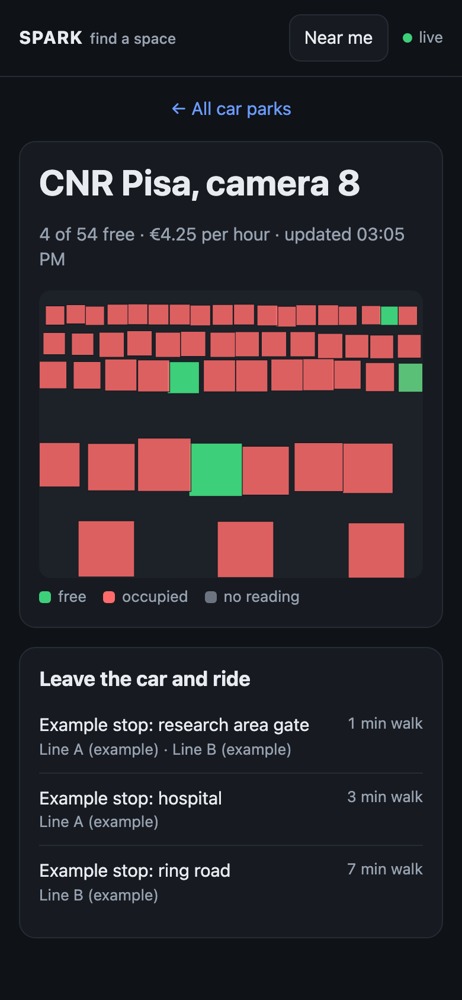
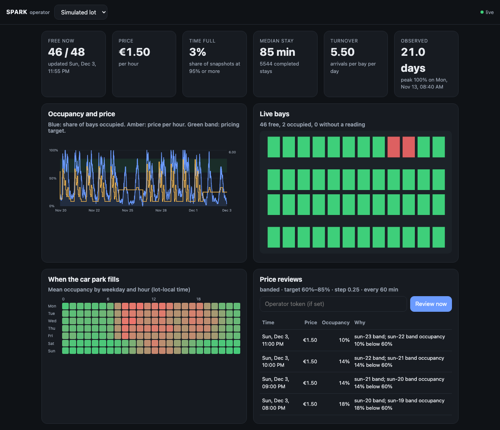

# SPARK

**Camera-based parking occupancy on affordable hardware, with live availability for
drivers, demand-responsive pricing and a dashboard for operators.**

A car park usually needs a sensor in every bay to know which are free. SPARK uses the
camera that is often already on the pole instead, and runs on a board small enough that a
lot which could never justify a sensor per space can still tell drivers where to go.



*A frame from a test day the model never trained on: green free, red occupied. All 54
bays are classified correctly here; a wrong bay would be outlined in yellow. Image from
CNRPark+EXT (ODbL).*

## Results

Measured on [CNRPark+EXT](http://cnrpark.it): 145k labelled bay images from 9 cameras over
a winter, split by day. Full method and tables in [docs/benchmark.md](docs/benchmark.md).

| | 2024 method (edge energy) | Smallest SparkNet (int8) | Shipped model (int8) |
|---|---:|---:|---:|
| Model | Laplacian threshold | 5.7 k params, 38 KB | 71 k params, 114 KB |
| Compute per bay | | 0.12 M MACs | 2.9 M MACs |
| Bay accuracy, test days | 86.2 % | 97.4 % | 98.9 % |
| Bay accuracy, cameras never seen in training¹ | 85.2 % | 95.7 % | 98.3 % |
| Accuracy in dim light (gamma 3) | 73.9 % | 94.6 % | 97.7 % |
| Whole frames: free count within one space | 42 % of frames | 78 % | **94 %** |
| Whole frames: mean error in the free count | 5.1 spaces | 0.95 | **0.34** |
| Latency, 32 bays, one CPU core² | 0.5 ms | 1.3 ms | 3.8 ms |

¹ The same architecture trained on cameras 1 to 6 only and tested on cameras 7 to 9.
² Apple M1 Max core, preprocessing included; a Raspberry Pi-class board is several times
slower, which is still far inside the budget of a camera read twice a second.



Pricing, measured in simulation against identical demand ([docs/pricing.md](docs/pricing.md)):

| Policy | Turned away (lot full) / day | Drivers served / day | Time at 95 %+ full |
|---|---:|---:|---:|
| Fixed price | 14.6 ± 1.8 | 320 | 4.4 % |
| One rolling price, reviewed hourly | 41.3 ± 2.3 | 368 | 7.4 % |
| **Price per day type and hour (shipped)** | **3.9 ± 1.1** | **354** | **2.4 %** |

The middle row is the obvious design, and the simulator showed it making things worse: it
drifts to its floor overnight and meets the morning peak at its cheapest. That is why the
shipped policy prices each hour separately, as SFpark did.

## What is in the box



- **Edge agent** (`spark edge`): reads a USB camera, RTSP stream, video file or folder of
  stills; warps each bay to an upright patch; classifies them in one batch with ONNX
  Runtime; smooths each bay over time (hysteresis plus a dwell time, defined in seconds so
  it behaves the same at any frame rate); posts state to the server and queues reports
  while the network is down. Needs numpy, OpenCV and onnxruntime, no deep-learning
  framework.
- **Server** (`spark serve`): FastAPI over SQLite. Bay state, change events, occupancy
  history, a weekly occupancy profile and forecast, banded demand-responsive pricing,
  dwell-time and turnover analytics, nearby transit stops from any GTFS feed, and a
  server-sent-events stream. Every time-based decision runs on observation time, so
  replaying recorded footage at 600x gives the same results as watching live.
- **Driver app** (`/`): an installable web app. Car parks by distance with free spaces and
  price, a live map of the bays drawn in the camera's own geometry, transit stops within
  walking distance, other car parks with space when this one is full.
- **Operator dashboard** (`/admin`): free spaces, price, time spent full, median stay,
  turnover, occupancy and price against the pricing target, an hour-of-week heatmap, the
  live bay map, and every price review with its reason.
- **Bay mapper** (`/mapper`): load a still from a new camera, click the corners of each
  bay, download the lot file. Runs entirely in the browser.
- **Benchmark** (`spark bench`): the training, export, quantisation, stress tests,
  latency measurements and whole-frame replay behind every number above.

| Driver app | Operator dashboard (simulated lot) |
|---|---|
|  |  |

## Run it

Needs Python 3.12 and [uv](https://docs.astral.sh/uv/).

```bash
uv sync                          # runtime and dev tools
uv run spark demo --synthetic    # simulated cars, nothing to download
```

Open <http://127.0.0.1:8000> for the driver app and <http://127.0.0.1:8000/admin> for the
dashboard. To watch a real camera instead, fetch the dataset (about 1.5 GB) and replay
camera 8 of CNRPark+EXT through the full pipeline:

```bash
uv sync --all-extras             # adds torch, scikit-learn, matplotlib for the benchmark
uv run spark data download --full && uv run spark data cache
uv run spark demo --speed 6000   # 23 days of footage in about three minutes
```

Point it at your own camera:

```bash
uv run spark serve --lots configs/lots          # one JSON file per lot, from /mapper
uv run spark edge --lot configs/lots/my-lot.json --source 0 --token "$SPARK_DEVICE_TOKEN"
```

[`deploy/spark-edge.service`](deploy/spark-edge.service) is an example systemd unit for
running the agent on a board. Set `SPARK_DEVICE_TOKEN` and `SPARK_ADMIN_TOKEN` on the
server; without them the endpoints are open, which is only right on a laptop.

Reproduce the numbers:

```bash
make bench     # ~1 hour on an M1 Max: trains 27 models, exports and quantises 9
make replay    # whole-frame accuracy of the shipped model and the baselines
make sim       # pricing policies, 5 seeds
make check     # ruff, mypy --strict, pytest
```

## Repository

```
src/spark/
  lot.py            lots, bays and their geometry
  vision/           patch extraction, classifiers, SparkNet, training, ONNX export, smoothing
  edge/             frame sources and the agent
  server/           API, store, pricing, forecast, transit, web apps
  sim/              demand model and pricing policy comparison
  bench/            benchmark, stress tests, latency, whole-frame replay, report
  data/cnrpark.py   dataset download, cache and evaluation protocols
models/             every benchmarked artefact; default.onnx is the shipped one
results/            raw benchmark, replay and pricing results (JSON)
docs/               architecture, benchmark, pricing
```

## History

SPARK began in 2024 as a semester project in my Computer Vision course at SRM Institute of
Science and Technology and became my major project, built with teammates. That version
covered real-time occupancy detection, a dynamic pricing engine, links to public
transport and ride-sharing, a mobile app for drivers and an admin dashboard. I
co-authored the paper *Smart Parking System Using Computer Vision Based Parking Spot
Detection and IoT Based Real Time Monitoring* and presented it remotely at ICCCNet-2025,
hosted by Manchester Metropolitan University
([SSRN, doi:10.2139/ssrn.5852982](https://doi.org/10.2139/ssrn.5852982)).

This repository is a ground-up rewrite (2026). The detector went from a hand-tuned edge
threshold to a measured family of small CNNs; the pricing engine went from rules to a
policy chosen by simulation; and every claim is now a number someone else can reproduce.
Ride-sharing links are not part of this version.

## Data and licences

CNRPark+EXT is by Amato, Carrara, Falchi, Gennaro, Meghini and Vairo, *Deep learning for
decentralized parking lot occupancy detection*, Expert Systems with Applications 72
(2017), and is licensed under the [Open Database License](https://opendatacommons.org/licenses/odbl/1-0/).
The models in `models/` and the frame above are produced works of that database. The
transit stops in `configs/gtfs-example` are made-up examples.
