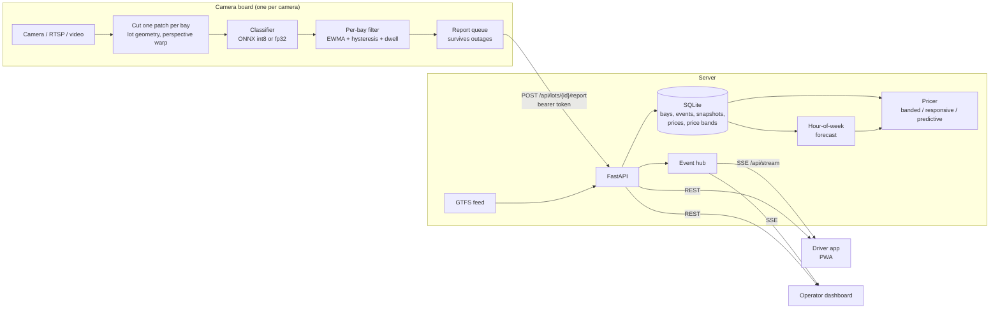

# Architecture

SPARK has three moving parts: an **edge agent** next to each camera, a **server** that
holds the live state of every lot, and two **web apps** (drivers and operators) that read
from the server. They talk over plain HTTP and server-sent events, so any of them can be
replaced without touching the others.



## The edge agent

`spark.edge.agent` runs a loop: read a frame, cut a patch for every bay, classify the
batch, smooth the result, publish.

- **Geometry.** A lot is a JSON file listing each bay as a polygon in the camera's pixel
  space (`spark.lot`). Draw it once with the mapper page (`/mapper`) on a still from the
  camera. Quadrilaterals are warped to an upright square, so every bay reaches the
  classifier the same way up whatever the camera angle (`spark.vision.patches`). If the
  camera's resolution changes, the polygons are rescaled.
- **Classifier.** Anything with `predict_proba(patches) -> P(occupied)`. The deployed ones
  need only numpy, OpenCV and onnxruntime; torch and scikit-learn are training-time only.
  See [benchmark.md](benchmark.md) for how the default model was chosen.
- **Smoothing.** A single frame lies: a person crossing a bay, a car driving past, a
  shadow. `BayFilter` keeps an exponentially weighted probability per bay, with a time
  constant in seconds rather than frames, and only flips a bay's state after it has
  crossed a hysteresis band (0.65 to turn occupied, 0.35 to turn free) and stayed there
  for a dwell time. For sources that are minutes apart, such as the CNRPark+EXT stills,
  the agent trusts each frame instead.
- **Outages.** Reports go into a bounded queue and are sent oldest first, with
  exponential backoff while the server is unreachable. The server ignores a report that is
  older than what it already holds for a bay, so a late flush cannot roll state back.

## The server

`spark.server` is a FastAPI app over a single SQLite file in WAL mode.

| Table | One row per | Used for |
|---|---|---|
| `bays` | bay | current state, probability, since when |
| `events` | state change | dwell times, turnover, busiest bays |
| `snapshots` | lot per minute (at most) | occupancy history, the forecast profile, price reviews |
| `prices` | price review | price history shown to operators |
| `price_bands` | lot, day type and hour | the banded pricing schedule |

**Time.** Every time-based decision uses the observation time sent by the agent, not the
server clock. Snapshots, price reviews and forecasts therefore behave the same whether a
camera is live or 23 days of recorded stills are replayed in four minutes, which is how
the demo and the tests work.

**Pricing** is described in [pricing.md](pricing.md).

**Auth.** Agents send `SPARK_DEVICE_TOKEN` as a bearer token; operator actions need
`SPARK_ADMIN_TOKEN`. Both are compared in constant time. If unset, the endpoints are open
and the server logs a warning, which is convenient on a laptop and wrong anywhere else.

**Live updates.** Each accepted report that changes something is pushed to every open
`/api/stream` connection. A slow client loses its oldest messages rather than holding up
the others.

## The apps

Both are plain ES modules served by the API, with no build step and no third-party
requests at runtime.

- **Driver app** (`/`): car parks sorted by distance with free count and price, a live
  bay map drawn in the camera's own coordinates, transit stops within walking distance
  (from any GTFS feed), and other car parks with space when this one is full. It installs
  as a progressive web app, and the shell works offline.
- **Operator dashboard** (`/admin`): free spaces, price, share of time full, median stay,
  turnover, an occupancy and price timeline against the pricing target band, an
  hour-of-week heatmap, the live bay map and the log of price reviews, each with its reason.

## Interfaces

The OpenAPI schema is served at `/docs`. The edge contract is one request:

```http
POST /api/lots/cnr-camera8/report
Authorization: Bearer <device token>
Content-Type: application/json

{"t": 1448179560, "model": "sparknet-w0.5-r48-int8",
 "bays": {"603": {"occupied": true, "p": 0.97}, "604": {"occupied": false, "p": 0.04}}}
```
