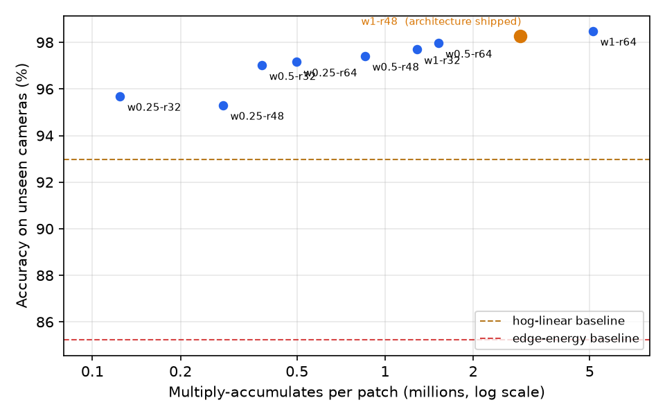

# Benchmark: how small can the detector be?

A camera board in a car park has a few watts and an ARM CPU. The question this benchmark
answers is the one that decides the hardware: **how much model does it take to tell an
occupied bay from a free one, reliably, in conditions the model was not trained on?**

Everything here is reproducible:

```bash
uv run spark data download --full && uv run spark data cache   # ~1.5 GB, a few minutes
uv run spark bench run                                          # ~1 hour on an M1 Max
uv run spark bench replay --model models/default.onnx           # end-to-end, whole frames
```

<!-- RUN -->
Run started 2026-10-28 11:23, finished 2026-10-28 12:10, torch 2.14.1, 8 epochs per model.
<!-- /RUN -->

## Data

[CNRPark+EXT](http://cnrpark.it) (Amato et al., 2017): 144,965 labelled 150x150 patches
of parking spaces from 9 cameras at the CNR research area in Pisa, taken roughly every
30 minutes between November 2015 and February 2016, in sunny, overcast and rainy weather.
The cameras look at the lot from different heights and angles, and trees, lamp posts and
other cars partly hide many bays. Licensed under the Open Database License (ODbL) v1.0.

## Protocols

Every protocol keeps the dataset's own split by **day**, so no test image was taken on a
day that appears in training. Two of them also hold out a condition entirely:

<!-- SPLITS -->
| Protocol | What it tests | Train | Val | Test |
|---|---|---:|---:|---:|
| `standard` | train, val and test days as published with the dataset | 94,493 | 18,647 | 31,825 |
| `sun-to-cloud-and-rain` | train on sunny days, test on overcast and rainy days | 44,232 | 6,346 | 19,225 |
| `unseen-cameras` | train on cameras 1-6, test on cameras 7-9 (test days) | 56,597 | 11,129 | 12,748 |
<!-- /SPLITS -->

`unseen-cameras` is the closest to deploying in a new car park: the model has never seen
these viewpoints. `sun-to-cloud-and-rain` asks whether a model trained in good weather
survives bad weather.

## Models

| Model | What it is |
|---|---|
| `edge-energy` | Mean Laplacian edge response of the grey patch through a fitted logistic curve. This is the 2024 prototype's method (a hand-tuned Laplacian threshold), kept as the historical baseline. Two parameters. |
| `hog-linear` | Histogram of oriented gradients and logistic regression. The classic pre-deep-learning approach. 1,765 parameters. |
| `sparknet-wW-rR` | A small CNN: a strided stem then six depthwise-separable blocks with ReLU6, global pooling and one logit. `W` scales every layer's width (0.25, 0.5, 1); `R` is the input resolution (32, 48 or 64 px). Trained 8 epochs with AdamW and a one-cycle schedule, with lighting augmentation (gamma, contrast, brightness, colour cast) and occlusion augmentation (random erasing of up to a third of the patch). |

Each SparkNet trained on the `standard` split is exported to ONNX and quantised to int8
(static, QDQ, per-channel weights, calibrated on 512 training patches).

## Accuracy

Accuracy (%) on each protocol's test set, with ROC AUC in brackets.

<!-- ACCURACY -->
| Model | standard | unseen-cameras | sun-to-cloud-and-rain |
|---|---:|---:|---:|
| `edge-energy` | 86.2 (92.80) | 85.2 (92.35) | 91.3 (98.14) |
| `hog-linear` | 94.7 (98.55) | 93.0 (97.61) | 95.3 (98.89) |
| `sparknet-w0.25-r32` | 97.4 (99.64) | 95.7 (99.23) | 96.6 (99.38) |
| `sparknet-w0.25-r48` | 98.0 (99.76) | 95.3 (99.05) | 96.4 (99.37) |
| `sparknet-w0.25-r64` | 97.6 (99.70) | 97.2 (99.51) | 97.2 (99.47) |
| `sparknet-w0.5-r32` | 97.9 (99.76) | 97.0 (99.60) | 96.8 (99.54) |
| `sparknet-w0.5-r48` | 98.1 (99.81) | 97.4 (99.66) | 97.4 (99.60) |
| `sparknet-w0.5-r64` | 98.6 (99.84) | 98.0 (99.73) | 97.2 (99.60) |
| `sparknet-w1-r32` | 98.7 (99.87) | 97.7 (99.70) | 97.8 (99.72) |
| `sparknet-w1-r48` | 98.9 (99.91) | 98.3 (99.80) | 97.8 (99.74) |
| `sparknet-w1-r64` | 98.9 (99.90) | 98.5 (99.79) | 98.1 (99.75) |
<!-- /ACCURACY -->



## What gets deployed

Every artefact trained on the `standard` split, measured on its test set. Latency is
the median wall-clock time of `predict_proba` with onnxruntime pinned to **one CPU thread**
on an Apple M1 Max, for one bay and for 32 bays (a typical camera's share of a lot),
preprocessing included. A Raspberry Pi-class board will be several times slower; the
multiply-accumulate (MAC) count is the hardware-independent figure.

<!-- DEPLOYED -->
| Artefact | Input | Params | MACs / patch | File | Accuracy | 1 bay (ms) | 32 bays (ms) |
|---|---:|---:|---:|---:|---:|---:|---:|
| `edge-energy` | 64 | 2 | – | 1 KB | 86.2 | 0.03 | 0.54 |
| `hog-linear` | 64 | 1,765 | – | 22 KB | 94.7 | 0.06 | 1.74 |
| `sparknet-w0.25-r32` | 32 | 5,705 | 0.12 M | 32 KB | 97.4 | 0.06 | 1.47 |
| `sparknet-w0.25-r32-int8` | 32 | 5,705 | 0.12 M | 38 KB | 97.4 | 0.07 | 1.31 |
| `sparknet-w0.25-r48` | 48 | 5,705 | 0.28 M | 32 KB | 98.0 | 0.11 | 3.12 |
| `sparknet-w0.25-r48-int8` | 48 | 5,705 | 0.28 M | 38 KB | 98.0 | 0.12 | 2.99 |
| `sparknet-w0.25-r64` | 64 | 5,705 | 0.50 M | 32 KB | 97.6 | 0.18 | 5.07 |
| `sparknet-w0.25-r64-int8` | 64 | 5,705 | 0.50 M | 38 KB | 97.6 | 0.19 | 5.27 |
| `sparknet-w0.5-r32` | 32 | 19,409 | 0.38 M | 85 KB | 97.9 | 0.08 | 2.16 |
| `sparknet-w0.5-r32-int8` | 32 | 19,409 | 0.38 M | 56 KB | 97.9 | 0.07 | 1.31 |
| `sparknet-w0.5-r48` | 48 | 19,409 | 0.85 M | 85 KB | 98.1 | 0.14 | 4.37 |
| `sparknet-w0.5-r48-int8` | 48 | 19,409 | 0.85 M | 56 KB | 98.0 | 0.12 | 2.99 |
| `sparknet-w0.5-r64` | 64 | 19,409 | 1.52 M | 85 KB | 98.6 | 0.22 | 7.11 |
| `sparknet-w0.5-r64-int8` | 64 | 19,409 | 1.52 M | 56 KB | 98.5 | 0.19 | 5.26 |
| `sparknet-w1-r32` | 32 | 70,817 | 1.28 M | 283 KB | 98.7 | 0.14 | 4.08 |
| `sparknet-w1-r32-int8` | 32 | 70,817 | 1.28 M | 114 KB | 98.7 | 0.08 | 1.66 |
| `sparknet-w1-r48` | 48 | 70,817 | 2.89 M | 283 KB | 98.9 | 0.25 | 7.70 |
| `sparknet-w1-r48-int8` | 48 | 70,817 | 2.89 M | 114 KB | 98.9 | 0.13 | 3.77 |
| `sparknet-w1-r64` | 64 | 70,817 | 5.13 M | 283 KB | 98.9 | 0.38 | 12.96 |
| `sparknet-w1-r64-int8` | 64 | 70,817 | 5.13 M | 114 KB | 98.9 | 0.23 | 6.44 |
<!-- /DEPLOYED -->

## Robustness

Two stress tests on 20,000 test patches from the `standard` split. Accuracy in %.

**Occlusion.** A band covering a share of the patch is painted over one edge of it in a
random colour. A band hugging an edge is what the neighbouring car or a passing van looks
like from a pole-mounted camera.

<!-- OCCLUSION -->
| Model (Occluded share) | 0.0 | 0.1 | 0.2 | 0.3 | 0.4 |
|---|---:|---:|---:|---:|---:|
| `edge-energy` | 86.1 | 86.3 | 85.9 | 83.9 | 79.1 |
| `hog-linear` | 94.8 | 91.1 | 74.0 | 80.0 | 74.9 |
| `sparknet-w0.25-r32` | 97.4 | 96.8 | 95.7 | 93.7 | 90.1 |
| `sparknet-w0.25-r48` | 98.1 | 97.5 | 95.9 | 94.5 | 92.6 |
| `sparknet-w0.25-r64` | 97.7 | 97.1 | 96.3 | 95.0 | 93.9 |
| `sparknet-w0.5-r32` | 98.0 | 97.1 | 95.9 | 94.3 | 92.2 |
| `sparknet-w0.5-r48` | 98.1 | 97.0 | 95.7 | 93.3 | 91.2 |
| `sparknet-w0.5-r64` | 98.6 | 97.9 | 95.6 | 94.4 | 95.5 |
| `sparknet-w1-r32` | 98.7 | 97.9 | 96.8 | 94.9 | 92.5 |
| `sparknet-w1-r48` | 98.9 | 98.0 | 97.0 | 96.4 | 95.0 |
| `sparknet-w1-r64` | 98.9 | 98.5 | 97.4 | 96.6 | 96.2 |
<!-- /OCCLUSION -->

**Darkness.** Pixel intensities are raised to a power (gamma), which darkens mid-tones
the way dusk does. Gamma 3 is a dim evening.

<!-- LIGHTING -->
| Model (Gamma) | 1.0 | 1.5 | 2.0 | 3.0 |
|---|---:|---:|---:|---:|
| `edge-energy` | 86.1 | 83.7 | 79.9 | 73.9 |
| `hog-linear` | 94.8 | 94.8 | 94.6 | 92.8 |
| `sparknet-w0.25-r32` | 97.4 | 96.9 | 96.4 | 94.3 |
| `sparknet-w0.25-r48` | 98.1 | 97.7 | 97.1 | 95.5 |
| `sparknet-w0.25-r64` | 97.7 | 97.3 | 97.0 | 96.0 |
| `sparknet-w0.5-r32` | 98.0 | 97.8 | 97.6 | 96.2 |
| `sparknet-w0.5-r48` | 98.1 | 97.4 | 96.4 | 95.0 |
| `sparknet-w0.5-r64` | 98.6 | 98.2 | 97.8 | 96.9 |
| `sparknet-w1-r32` | 98.7 | 98.5 | 98.0 | 96.8 |
| `sparknet-w1-r48` | 98.9 | 98.7 | 98.5 | 97.6 |
| `sparknet-w1-r64` | 98.9 | 98.8 | 98.6 | 97.7 |
<!-- /LIGHTING -->

## End to end, on whole frames

The tables above use the dataset's own crops. A deployed camera does something
different: it cuts each bay out of a 1000x750 frame using the lot geometry, then counts
the free spaces. `spark bench replay` runs exactly that path on every full frame from
the test days and scores what a driver would see.

<!-- REPLAY -->
| Artefact | Frames | Bays scored | Bay accuracy | Free-count error (mean, bays) | Count exact | Within 1 | Within 2 |
|---|---:|---:|---:|---:|---:|---:|---:|
| `edge-energy` | 896 | 31,825 | 85.2% | 5.11 | 20% | 42% | 52% |
| `hog-linear` | 896 | 31,825 | 94.0% | 1.70 | 26% | 59% | 76% |
| `sparknet-w0.25-r32-int8` | 896 | 31,825 | 97.1% | 0.95 | 55% | 78% | 89% |
| `default` (`sparknet-w1-r48-int8`) | 896 | 31,825 | 98.9% | 0.34 | 75% | 94% | 98% |
<!-- /REPLAY -->

## Findings

<!-- FINDINGS -->
1. **The 2024 method was the weak link.** Edge energy (a Laplacian threshold) gets 86 % of
   bays right on test days and 85 % on cameras it has never seen. On whole frames that is
   an average error of 5.1 spaces in the free count, and the count is within one space in
   only 42 % of frames. It also degrades fastest in the dark: 74 % at gamma 3.

2. **A CNN that fits in 32 KB beats it by eleven points.** The smallest SparkNet
   (width 0.25, 32 px, 5,705 parameters, 0.12 M multiply-accumulates per bay) reaches
   97.4 % on the standard split and 95.7 % on unseen cameras. That is a model small enough
   for almost any board, and it already makes about five times fewer errors than edge
   energy (2.6 % against 13.8 %).

3. **Accuracy keeps rising with compute, slowly.** From the smallest model to the
   largest (about 40 times the compute), unseen-camera accuracy goes from 95.7 % to 98.5 %.
   Width matters more than resolution: at 32 px, going from width 0.25 to 1 adds two
   points; at width 1, going from 32 to 64 px adds less than one.

4. **The models hold up under the conditions the old prototype struggled with.** Trained
   only on sunny days, the largest model scores 98.1 % on overcast and rainy days. With 40 %
   of the patch painted over, it still scores 96.2 %; HOG drops to 75 %. At gamma 3 it
   scores 97.7 %.

5. **int8 pays off only for the bigger models.** Quantisation changes accuracy by at most
   0.1 points anywhere. For the width-1 models it makes files 2.5 times smaller and
   roughly halves latency (32 bays at 48 px: 7.7 ms to 3.8 ms). For the width-0.25 models it
   gives no speed-up and a slightly *larger* file: their convolutions are already cheap,
   and the quantise and dequantise steps cost as much as they save.

6. **What ships.** The rule: the fastest int8 artefact within 0.5 points of the best
   unseen-camera accuracy. That is `sparknet-w1-r48-int8` (98.3 % on unseen cameras, 114 KB,
   3.8 ms for 32 bays on one M1 Max core), shipped as `models/default.onnx`. On whole
   frames from the test days it gets 98.9 % of bays right; the free-space count is exact in
   75 % of frames, within one space in 94 % and within two in 98 %.

### Limits

- Latency is measured on a laptop core. The MAC counts transfer; the milliseconds do
  not. On a Raspberry Pi-class board, expect several times slower, which is still far
  inside the budget of a camera that classifies twice a second.
- CNRPark+EXT is one site, in one city, over one winter. Unseen cameras are a fair proxy
  for a new car park, not a guarantee; a new site should be checked with a few hundred
  labelled patches of its own before going live.
- Each configuration was trained once (seed 0). Differences below about half a point
  between neighbouring configurations are within run-to-run noise and should not be read
  as rankings.
<!-- /FINDINGS -->
